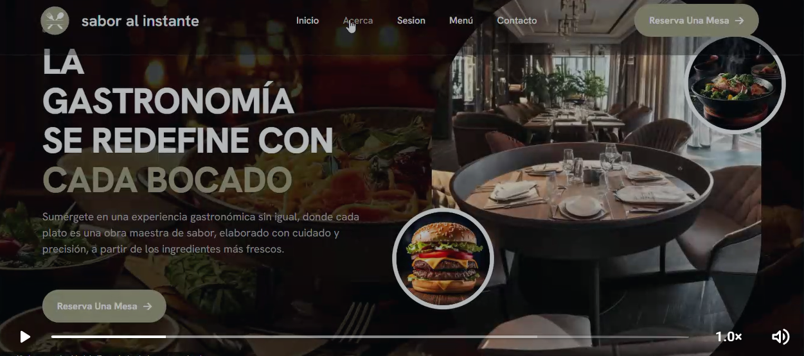
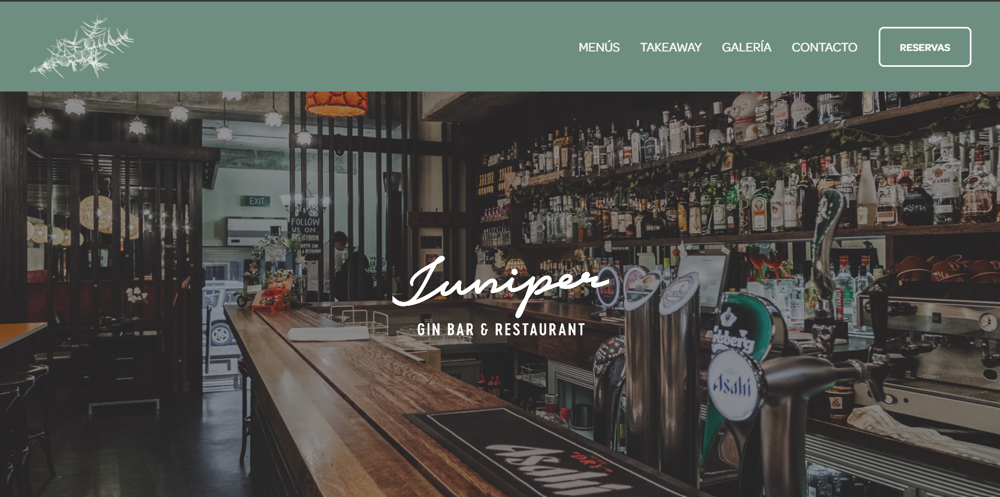
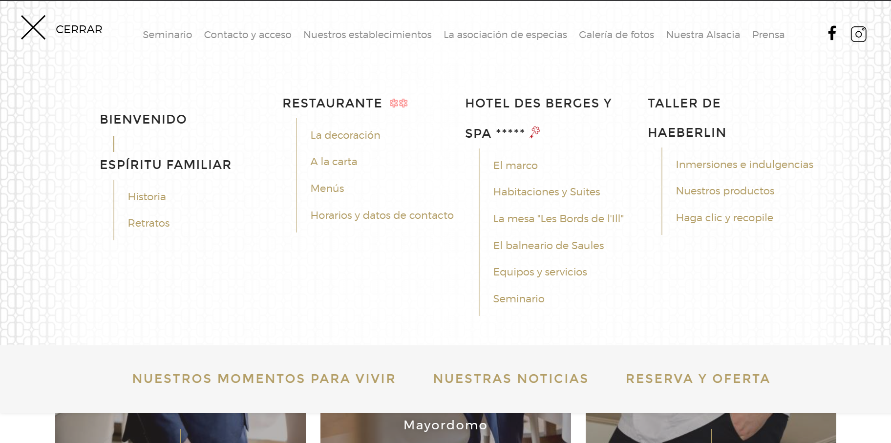
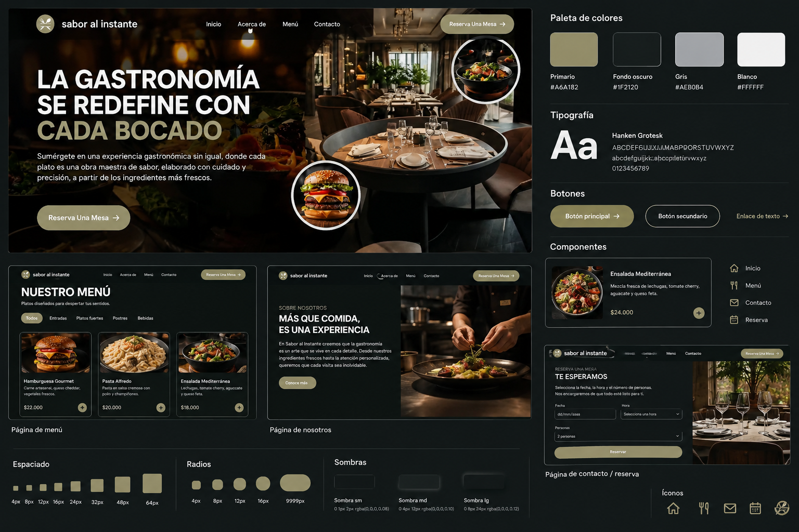

# IDENTIDAD VISUAL

## Sabor al Instante

*Guía técnica para ELE-11*

## 1. Objetivo

Definir una guía visual coherente con la apariencia prevista para Sabor al Instante. La captura compartida muestra una experiencia gastronómica elegante, con fondos oscuros, fotografía de platos y restaurante, acentos oliva, tipografía clara y botones redondeados. Esta guía traduce esas decisiones en valores reutilizables para ELE-11 y las páginas de frontend posteriores.

Alcance: Permitir analizar la apariencia general, pero no confirma todos los valores exactos del CSS. Los colores principales proporcionados por la tarea se mantienen; las escalas adicionales son propuestas que deben validarse con los archivos originales cuando estén disponibles.

## 2. Dirección visual

| Característica | Decisión visual | Aplicación |
| --- | --- | --- |
| Personalidad | Gastronómica, cálida, elegante y contemporánea. | Mantener una experiencia visual cuidada, sin exceso de elementos decorativos. |
| Composición | Hero amplio con fotografía de fondo y contenido superpuesto. | Usar una imagen protagonista, un overlay oscuro y texto alineado a la izquierda. |
| Contraste | Texto blanco o gris claro sobre fondos oscuros. | Garantizar legibilidad encima de fotografías. |
| Acentos | Oliva suave para acciones principales y detalles de marca. | Aplicarlo en botones de reserva y elementos destacados. |
| Fotografía | Platos y espacios de restaurante con recortes circulares decorativos. | Mantener imágenes de buena calidad y coherencia de iluminación. |
| Navegación | Barra superior horizontal con enlaces y acción de reserva. | Reutilizar estructura, alineación y estados de interacción en todas las páginas. |

## 3. Paleta de colores

La captura presenta una base oscura con texto claro y acentos oliva. Se conservan los tres colores especificados en la tarea.

| Token | HEX | Uso recomendado |
| --- | --- | --- |
| --color-primary | #a6a182 | Oliva para botones de reserva, acentos y elementos activos. |
| --color-background-dark | #1f2120 | Carbón para fondo principal, navegación oscura y secciones oscuras. |
| --color-neutral-gray | #aeb0b4 | Gris para textos secundarios, bordes o elementos de apoyo. |
| --color-white | #ffffff | Texto principal sobre fondos oscuros e iconos. |
| --color-text-light | #e7e7e5 | Texto y títulos claros con menor brillo que el blanco puro. |
| --color-overlay | rgba(15, 16, 15, 0.60) | Capa oscura sobre fotografías para mejorar la lectura; ajustar según imagen. |
| --color-surface-dark | #292b29 | Tarjetas o paneles sobre fondos oscuros. |
| --color-border-dark | #454742 | Bordes discretos sobre superficies oscuras. |

Nota: los neutros y el overlay son sugerencias visuales inferidas de la captura, no valores extraídos del CSS. Comprobarlos en el código original.

## 4. Tipografía

La familia tipográfica indicada en los requisitos es Hanken Grotesk. La captura sugiere títulos en mayúsculas, grandes y de peso alto, junto a enlaces y párrafos más discretos.

| Token | Tamaño | Peso | Interlineado | Uso |
| --- | --- | --- | --- | --- |
| --font-size-xs | 12 px | 400 | 16 px | Etiquetas auxiliares. |
| --font-size-sm | 14 px | 400–500 | 20 px | Navegación y textos secundarios. |
| --font-size-base | 16 px | 400 | 24 px | Párrafos y contenido general. |
| --font-size-lg | 18 px | 500 | 28 px | Textos introductorios. |
| --font-size-xl | 24 px | 600 | 32 px | Títulos de sección. |
| --font-size-2xl | 32 px | 700 | 36–40 px | Títulos principales. |
| --font-size-hero | 48–56 px | 700 | 1.0–1.1 | Título protagonista en escritorio; adaptar a móvil. |

Recomendaciones: cargar Hanken Grotesk; usar títulos cortos, de alto contraste y con interlineado compacto; reducir el tamaño del título hero en pantallas pequeñas. Mantener una fuente sans-serif alternativa.

## 5. Espaciado y layout

Usar una escala basada en múltiplos de 4 y 8 px. En la captura, el contenido principal tiene márgenes amplios y los elementos de navegación están distribuidos horizontalmente.

| Token | Valor | Aplicación |
| --- | --- | --- |
| --spacing-1 | 4 px | Separaciones mínimas. |
| --spacing-2 | 8 px | Icono junto a texto; elementos relacionados. |
| --spacing-3 | 12 px | Separación compacta. |
| --spacing-4 | 16 px | Padding interno de controles. |
| --spacing-6 | 24 px | Separación entre grupos. |
| --spacing-8 | 32 px | Separación entre bloques. |
| --spacing-12 | 48 px | Separación de secciones. |
| --spacing-16 | 64 px | Márgenes amplios en escritorio. |

Layout recomendado para el hero: navegación en la parte superior; bloque de texto a la izquierda; fotografía protagonista a la derecha o de fondo; CTA de reserva visible; imágenes circulares secundarias solo si forman parte del diseño aprobado. En móvil, apilar contenido y evitar que texto o botones queden cubiertos por imágenes.

## 6. Bordes redondeados

| Token | Valor | Uso |
| --- | --- | --- |
| --radius-sm | 4 px | Etiquetas y elementos pequeños. |
| --radius-md | 8 px | Campos y controles. |
| --radius-lg | 12 px | Tarjetas y paneles. |
| --radius-xl | 16 px | Contenedores destacados. |
| --radius-pill | 9999 px | Botones de reserva tipo píldora, como en la captura. |
| --radius-circle | 50% | Imágenes circulares decorativas. |

La captura utiliza un botón de reserva muy redondeado y recortes de imagen circulares. Reservar estos tratamientos para acciones y elementos que lo requieran.

## 7. Sombras y capas

| Token | Valor CSS sugerido | Uso |
| --- | --- | --- |
| --shadow-sm | 0 1px 3px rgba(0,0,0,.18) | Controles y pequeños elementos sobre fondo oscuro. |
| --shadow-md | 0 4px 14px rgba(0,0,0,.25) | Tarjetas o elementos flotantes. |
| --shadow-lg | 0 8px 28px rgba(0,0,0,.32) | Elementos superpuestos cuando sea necesario. |
| --overlay-hero | linear-gradient(90deg, rgba(0,0,0,.78), rgba(0,0,0,.22)) | Capa sobre fotografía para sostener el contraste del texto. |

La prioridad es la capa oscura sobre la imagen del hero, no añadir sombras a todos los elementos. Ajustar el gradiente según la fotografía definitiva.

## 8. Componentes y reglas de estilo

| Componente | Reglas recomendadas |
| --- | --- |
| Barra de navegación | Fondo oscuro o translúcido; marca a la izquierda; enlaces centrados o alineados en una fila; acción de reserva destacada a la derecha. |
| Botón principal | Fondo oliva, texto claro, forma píldora, icono/flecha opcional y estados hover/focus visibles. |
| Título hero | Hanken Grotesk en peso alto, mayúsculas, interlineado compacto y ancho controlado. |
| Texto descriptivo | Gris claro, tamaño de 16 px aproximadamente y ancho limitado para facilitar lectura. |
| Fotografía principal | Imagen de alta calidad, recorte adaptable y overlay oscuro donde haya texto. |
| Imágenes circulares | Borde claro visible y recorte circular; usar con moderación y evitar tapar navegación o contenido. |
| Enlaces de navegación | Texto claro, tamaño compacto, espacio consistente y estado activo/hover perceptible. |
| Formularios | Fondos y bordes coherentes con la paleta oscura; etiquetas legibles y estados de error/foco claramente diferenciados. |

## 9. Recomendaciones concretas para ELE-11

Crear o actualizar tokens globales en el archivo de estilos existente, sin duplicar variables.

Definir los colores de marca, tipografía, espaciado, radios y sombras como variables CSS reutilizables.

Implementar estilos compartidos para navegación, botones, formularios y tarjetas.

Establecer un hero adaptable con overlay oscuro y texto legible sobre fotografía.

Definir estados hover, focus, active y disabled para controles interactivos.

Verificar contraste y accesibilidad, especialmente en texto colocado sobre imágenes.

Probar el diseño en escritorio, tablet y móvil; en móvil, reorganizar navegación y apilar el contenido del hero.

Validar los tokens propuestos contra HTML y CSS existentes antes de marcarlos como definitivos.

## 10. Ejemplo de tokens CSS

:root {
  --color-primary: #a6a182;
  --color-background-dark: #1f2120;
  --color-neutral-gray: #aeb0b4;
  --color-white: #ffffff;
  --color-text-light: #e7e7e5;
  --color-surface-dark: #292b29;
  --color-border-dark: #454742;

  --font-family-base: "Hanken Grotesk", sans-serif;
  --font-size-sm: 14px;
  --font-size-base: 16px;
  --font-size-lg: 18px;
  --font-size-xl: 24px;
  --font-size-2xl: 32px;
  --font-size-hero: 52px;

  --spacing-1: 4px;
  --spacing-2: 8px;
  --spacing-3: 12px;
  --spacing-4: 16px;
  --spacing-6: 24px;
  --spacing-8: 32px;
  --spacing-12: 48px;
  --spacing-16: 64px;

  --radius-sm: 4px;
  --radius-md: 8px;
  --radius-lg: 12px;
  --radius-xl: 16px;
  --radius-pill: 9999px;

  --shadow-sm: 0 1px 3px rgba(0,0,0,.18);
  --shadow-md: 0 4px 14px rgba(0,0,0,.25);
  --shadow-lg: 0 8px 28px rgba(0,0,0,.32);
}

Este código es orientativo. Debe adaptarse a la estructura del proyecto y contrastarse con los estilos actuales antes de incorporarlo.

## 11. Referencia visual analizada

Se incluyeron tres referencias visuales y una propuesta ilustrativa de cómo podría verse el sistema completo. Las capturas de otros sitios se presentan únicamente como inspiración; la propuesta generada es un mockup y no una pantalla implementada.

**Figura 1. Captura de referencia del sitio Sabor al Instante.**

Observaciones: tomar como referencia la composición general, la jerarquía del título, el uso de fotografía gastronómica y la ubicación de la llamada a la acción. Validar los colores y componentes con los archivos reales del proyecto.

**Figura 2. Referencia de página principal de Juniper Gin Bar & Restaurant.**

Observaciones: fotografía amplia como fondo, filtro oscuro para mantener la legibilidad y encabezado verde grisáceo. Puede orientar el tratamiento de imágenes y la navegación, sin copiar la identidad de otra marca.

**Figura 3. Referencia de organización de contenidos en columnas.**

Observaciones: títulos claros, agrupación de enlaces, espacios generosos y acentos dorados. Estos recursos pueden orientar la organización de menús, galerías y secciones informativas.

**Figura 4. Propuesta visual ilustrativa para Sabor al Instante (mockup generado).**

Observaciones: propuesta de conjunto para visualizar una posible aplicación de la paleta oscura, acentos oliva, tipografía destacada y componentes de interfaz. Es una referencia conceptual; no representa el estado actual del código ni sustituye las capturas reales del proyecto.

## Imágenes de referencia

Las imágenes siguientes se extrajeron del documento Word. Revisa sus nombres y conserva solo las que correspondan a las figuras descritas arriba.

